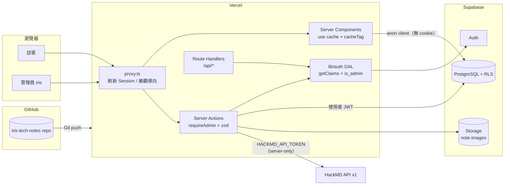
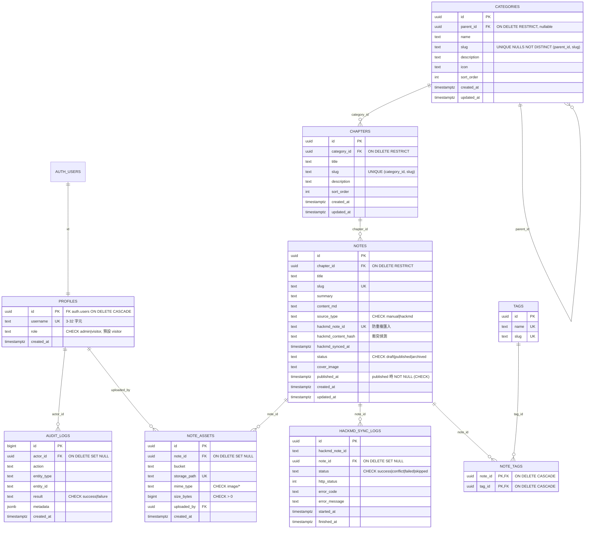

# Iris Notes — 架構、安全與開發計畫

> 本文件是 Phase 1 的架構檢查成果。版本號均為 2026-10-11 實際以 `npm view` 查到並安裝、通過 build 的版本。

## 1. 技術架構與安全風險分析

### 1.1 已確認的版本事實（影響實作方式）

| 項目 | 事實 | 對本專案的影響 |
|---|---|---|
| Next.js 16.4 | `middleware` 已更名為 `proxy`（`proxy.ts`） | Session 刷新寫在 `proxy.ts`，不使用 `middleware.ts` |
| Next.js 16.4 | 預設啟用 Cache Components（`cacheComponents: true`） | ISR 以 `'use cache'` + `cacheLife({ revalidate: 3600 })` + `cacheTag()` 實作；讀取 `cookies()` 的元件必須包在 `<Suspense>` 內 |
| Next.js 16.4 | `revalidateTag(tag)` 單參數已淘汰 | Server Action 內使用 `updateTag()`；Route Handler 使用 `revalidateTag(tag, { expire: 0 })` |
| Next.js 16.4 | `error.tsx` 的重試函式為 `retry()` | 已套用 |
| @supabase/ssr 0.12 | 僅支援 `getAll` / `setAll`；`setAll` 第二參數提供防 CDN 快取 headers | 已在 proxy 中轉寫這些 headers |
| supabase-js 2.117 | 伺服器端驗證身分應使用 `getClaims()` / `getUser()`，不可信任 `getSession()` | proxy 與後續 DAL 一律使用 `getClaims()` |
| Tailwind 4.3 | CSS-first 設定（`@theme`），無 `tailwind.config.js` | MD3 tokens 寫在 `app/globals.css` |
| zod 4 | `z.string({ error })` 取代 `required_error` | 已套用 |

### 1.2 安全風險與對策

| # | 風險 | 嚴重度 | 對策 |
|---|---|---|---|
| R1 | 規格中的開發密碼 `1234` 若被沿用到正式環境，帳號可被瞬間猜中 | 高 | 不寫入任何程式或 migration。Supabase Auth 預設最短 6 碼，`1234` 本身就無法建立；請在 Dashboard 將最短長度設為 12 以上並啟用 leaked password protection（若方案支援） |
| R2 | anon / publishable key 本來就是公開的，所有防護仰賴 RLS | 高 | 每張表啟用 RLS，預設拒絕；寫入一律 `is_admin()` 檢查。env 驗證會拒絕把 `service_role` / `sb_secret_` 金鑰放進 `NEXT_PUBLIC_` 變數（已實作 + 單元測試） |
| R3 | 一般使用者透過更新 `profiles.role` 自行升級為 admin | 高 | `REVOKE UPDATE ON profiles FROM authenticated`，只 `GRANT UPDATE (username)`；`is_admin()` 為 `SECURITY DEFINER` 並固定 `search_path` |
| R4 | 快取外洩：把含 cookie 的查詢結果放進共享快取，使草稿被快取給訪客 | 高 | `'use cache'` 內只能使用 `createSupabasePublicClient()`（無 cookie、anon role）。管理頁一律動態渲染 |
| R5 | 只靠 proxy 保護 `/admin`（Next.js 曾有 middleware 繞過漏洞 CVE-2025-29927） | 高 | proxy 僅做樂觀導向；每個 Server Action / Route Handler 呼叫 `requireAdmin()`；資料庫 RLS 為最後防線 |
| R6 | Markdown XSS（`<script>`、`javascript:` 連結、`onerror` 屬性） | 高 | 不使用 `rehype-raw`；`react-markdown` 預設不渲染 HTML；`urlTransform` 只允許 `http/https/mailto/#/相對路徑`；加測試 |
| R7 | HackMD Token 外洩 | 高 | 只存在 Vercel Server 環境變數 `HACKMD_API_TOKEN`；`lib/env.server.ts` 帶 `server-only`；設定頁只顯示「已設定 / 未設定」，絕不回傳值。不存入資料庫（避免需另行加密） |
| R8 | 公開 bucket 存放草稿圖片，知道網址即可讀取 | 中 | 建議雙 bucket：`note-images`（public，已發布）與 `note-drafts`（private，signed URL）；發布時複製。**此為 Phase 6 待確認決策**，見 §7 |
| R9 | Open redirect（`/login?next=https://evil`） | 中 | `safeRedirectPath()` 只接受站內相對路徑（已實作 + 測試） |
| R10 | 登入暴力破解 | 中 | Supabase Auth 內建速率限制；登入錯誤訊息不區分帳號或密碼錯誤 |
| R11 | 以 username `iris` 登入時洩漏 Email | 中 | MVP 使用 Email 登入，登入後顯示 `iris`（規格允許）。日後若做 username 登入，由 Server Action 查詢並直接呼叫 `signInWithPassword`，Email 不回傳前端，且錯誤訊息一致 |
| R12 | 中文全文搜尋：PostgreSQL 內建 text search 不會斷中文詞 | 低（功能性） | Phase 3 使用 `pg_trgm` GIN 索引 + `ILIKE`，資料量大時再評估 PGroonga |
| R13 | Supabase 帳單用量無公開即時 API | 低（功能性） | 只顯示「App 估算用量（`note_assets.size_bytes` 加總）」；計費用量顯示為「請至 Supabase Dashboard 查看」，不虛構剩餘額度 |

## 2. 系統架構圖



## 3. Database ERD（Phase 2 實作目標）



**RLS 原則（Phase 2）**：訪客只能 `SELECT` `status = 'published'` 的筆記及其分類、章節、標籤；所有 `INSERT/UPDATE/DELETE` 需 `public.is_admin()`；`audit_logs`、`hackmd_sync_logs` 僅 admin 可讀、只能新增不可修改。刪除分類 / 章節時以 FK `RESTRICT` 阻擋，UI 另顯示關聯筆記數量。

## 4. Next.js 資料夾結構

```
iris-tech-notes/
├─ app/
│  ├─ layout.tsx · page.tsx · error.tsx · not-found.tsx · globals.css   ← Phase 1 ✅
│  ├─ design-system/                 ← Phase 1 驗收頁 ✅
│  ├─ api/health/route.ts            ← Phase 1 ✅
│  ├─ login/                         ← Phase 2
│  ├─ categories/ · categories/[slug]/ · notes/[id]/ · search/   ← Phase 3
│  └─ admin/
│     ├─ layout.tsx（Sidebar / Breadcrumb）· page.tsx            ← Phase 4
│     ├─ notes/ · notes/new/ · notes/[id]/edit/                   ← Phase 4
│     ├─ categories/ · chapters/ · logs/ · settings/              ← Phase 4
│     ├─ hackmd/                                                  ← Phase 5
│     └─ storage/                                                 ← Phase 6
├─ components/
│  ├─ ui/          Button · Card · Chip · StatusBanner · EmptyState · Skeleton ✅
│  ├─ layout/      SiteHeader · SiteFooter · BlurShapes ✅
│  ├─ theme/       ThemeToggle ✅
│  ├─ markdown/    MarkdownRenderer · CodeBlock · Toc               ← Phase 3
│  └─ admin/       Sidebar · NoteEditor · forms                     ← Phase 4
├─ lib/
│  ├─ env.ts · env.server.ts  ✅
│  ├─ theme.ts · utils/cn.ts  ✅
│  ├─ supabase/  client · server · public · proxy-session · health ✅
│  ├─ auth/      requireAdmin · getCurrentProfile                   ← Phase 2
│  ├─ notes/     queries（use cache）· mutations（Server Actions）    ← Phase 3–4
│  ├─ hackmd/    client · sync · errors                             ← Phase 5
│  └─ validations/ zod schemas                                      ← Phase 2+
├─ types/database.ts          ✅（Phase 2 以 supabase gen types 覆蓋）
├─ supabase/migrations/       ← Phase 2
├─ tests/unit · tests/e2e     ✅
├─ proxy.ts                   ✅
└─ next.config.ts · vitest.config.mts · playwright.config.ts · eslint.config.mjs ✅
```

## 5. 套件與版本

| 套件 | 版本 | 階段 |
|---|---|---|
| next | 16.4.0 | 1 |
| react / react-dom | 19.3.0 | 1 |
| typescript | 5.x（strict） | 1 |
| tailwindcss / @tailwindcss/turbopack | 4.3.x | 1 |
| @supabase/supabase-js | 2.117.3 | 1 |
| @supabase/ssr | 0.12.7 | 1 |
| zod | 4.6.x | 1 |
| lucide-react | 1.55.x | 1 |
| clsx / tailwind-merge | 2.1 / 3.7 | 1 |
| @fontsource-variable/roboto、jetbrains-mono | 5.3.x | 1 |
| vitest | 5.0.3 | 1 |
| @playwright/test | 1.64.0 | 1 |
| eslint / eslint-config-next | 9.x / 16.4.0 | 1 |
| react-markdown / remark-gfm / rehype-highlight / rehype-slug | 10.1 / 最新穩定 | 3（使用時才安裝） |
| react-hook-form / @hookform/resolvers | 最新穩定 | 4 |

字型透過 npm（@fontsource）自行託管，不在 build 時連線 Google Fonts，避免 Vercel build 因網路失敗。中文使用系統字型後備（PingFang TC / Microsoft JhengHei / Noto Sans TC）。

## 6. GitHub + Vercel 部署方案

詳細步驟見 README。重點：

- Vercel Framework Preset：Next.js；Root Directory：`./`；Node.js：22.x。
- 環境變數：`NEXT_PUBLIC_SUPABASE_URL`、`NEXT_PUBLIC_SUPABASE_ANON_KEY`（或 `..._PUBLISHABLE_KEY`）設定於 Production / Preview / Development；`HACKMD_API_TOKEN` 只設定 Production（必要時 Preview），**不勾選 Development 以外的公開用途**。
- Supabase Auth → URL Configuration：Site URL 設為正式網址；Redirect URLs 加入 `http://localhost:3000/**`、`https://<正式網址>/**`、`https://iris-tech-notes-*-<vercel-team>.vercel.app/**`。

## 7. 開發階段與驗收標準

| Phase | 範圍 | 驗收標準 |
|---|---|---|
| 1 ✅ | Next.js、Tailwind、Supabase client、Design System | lint / tsc / unit test / build 全過；`/design-system` 顯示連線狀態；深淺色切換保存；`/admin` 未登入導向 `/login`；client bundle 無 server 秘密 |
| 2 ✅ | Schema、RLS、Storage policy、管理員登入 | Migration 可在乾淨專案重跑；anon 讀不到草稿、無法寫入（以 SQL 測試驗證）；visitor 無法自升 admin；Email 登入 / 登出可用 |
| 3 ✅ | 公開網站、Markdown Renderer、搜尋 | ISR 生效；XSS 測試通過；TOC / Anchor / 上下篇 / 程式碼複製；手機可讀 |
| 4 ✅ | 後台 Dashboard、分類 / 章節 / 筆記 CRUD | 每個 Action 有 requireAdmin + zod；發布後 `updateTag` 使公開頁更新；刪除受限提示；audit log 寫入 |
| 5 | HackMD 匯入與同步 | 測試連線、列表、匯入為草稿、不重複、衝突比對畫面；401/403/404/429/5xx/逾時皆有訊息 |
| 6 | 圖片管理與容量警告 | MIME / 大小驗證、安全檔名、可設定額度、70/85/95% 警告；不顯示虛構計費額度 |
| 7 | 測試、安全檢查、部署 | Playwright 三種裝置通過；Vercel Production 部署成功；Push 自動部署 |

**Storage 決策（Phase 2 已實作）**：建立雙 bucket。`note-images` 為 public（只放可公開的圖片），`note-drafts` 為 private（草稿附件，Phase 6 以 signed URL 預覽）。兩者寫入皆限 admin，且 admin 也只能寫入這兩個 bucket。若日後確定不需要私有草稿，可只使用 `note-images`。

## 8. Phase 2 實作備註

- 實際 schema 在 ERD 之外新增：`profiles.updated_at`、`notes.sort_order`（章節內排序與上一篇 / 下一篇）、`notes.hackmd_content_hash` / `hackmd_synced_at`（Phase 5 衝突偵測）。
- 授權三層：`proxy.ts`（樂觀導向）→ `lib/auth/dal.ts` 的 `requireAdmin()`（每個 Server Action / Route Handler / 頁面）→ PostgreSQL RLS。
- 權限收斂：migration 先 `REVOKE ALL` 再逐表授權。**之後每個新增資料表的 migration 都必須自行寫 GRANT 與 RLS**，否則會沿用 Supabase 預設的全開權限（RLS 仍會擋，但不應依賴單一防線）。
- 稽核：登入、登出寫入 `audit_logs`。登入失敗無法以使用者身分寫入（尚非 admin），請以 Supabase Auth Logs 查詢。

## 9. Phase 3 實作備註

**快取策略（修正 Phase 1 的 ISR 規劃）**：公開頁的資料區塊在請求時渲染（`connection()` 或頁面頂層讀取 params），
資料查詢與 Markdown 渲染結果由 `'use cache'` + `cacheLife({ revalidate: 3600 })` + `cacheTag()` 快取。
原因：若在 build 時預先渲染資料，`next build` 就必須連得到 Supabase；Supabase 暫停或 CI 沒有金鑰時部署會失敗。
現行做法 build 不需資料庫，訪客仍讀取快取結果，Phase 4 發布後以 `updateTag()` 立即失效。

| 快取標籤 | 使用者 | Phase 4 何時失效 |
|---|---|---|
| `notes` | 首頁、分類、筆記、搜尋、標籤 | 任何筆記新增 / 修改 / 發布 / 封存 / 刪除 |
| `note:<id>` | 單篇筆記與其 Markdown 渲染 | 該筆記變動 |
| `categories` | 分類樹、breadcrumb、首頁計數 | 分類或章節變動 |
| `tags` | 筆記標籤、標籤頁、相關筆記、搜尋 | 標籤變動 |

**安全**：`'use cache'` 內只使用無 cookie 的 `createSupabasePublicClient()`；查詢另加 `status = 'published'`。
搜尋使用資料庫函式 `search_published_notes()`（SECURITY INVOKER、跳脫 `%` `_`），不在前端組 PostgREST filter 字串。
Markdown：`skipHtml`、不使用 `rehype-raw`、連結 / 圖片白名單（圖片只允許 https 與站內路徑）。

**404**：格式錯誤的網址（非 UUID 的筆記 id、非法 slug）由 `proxy.ts` 回傳真正的 HTTP 404。
格式正確但不存在或未發布的內容，因 layout 外框已開始串流，回應為 200 + not-found 畫面 + `noindex`（Next.js 16 官方行為）。

**Schema 調整**：`categories.slug` 改為全域唯一，讓 `/categories/[slug]` 可唯一定位（保留 `(parent_id, slug)` 約束供 seed 使用）。

## 10. Phase 4 實作備註

- **Server Action 模式**：每個 action 都視為公開 POST 端點，依序做 `requireAdmin()` → zod 驗證未知輸入 → 資料庫操作 →
  `mapDbError()`（只回傳友善訊息與欄位，不外洩資料庫原文）→ 稽核日誌（成功與失敗都記錄）→ `updateTag()` → `refresh()`。
- **筆記儲存**：`admin_save_note()`（SECURITY INVOKER，RLS 照常生效）在單一交易內寫入筆記與標籤；
  以 `updated_at` 做樂觀鎖，兩個分頁同時編輯時後存者會收到衝突提示，不會默默覆蓋。
- **標籤 slug**：英文名稱直接轉換；中文名稱使用穩定的 FNV-1a 雜湊（例如 `t-685761d3`），同名標籤永遠得到同一個 slug。
- **刪除限制**：分類（有子分類或章節）與章節（有筆記，含草稿）在 action 內先檢查並說明原因；FK `RESTRICT` 仍是最終防線。
- **表單**：React Hook Form + 同一份 zod schema（client 只為體驗，server 一定重新驗證）。
- **DAL 調整**：`getAuthorization()` 先 `await connection()`，因為驗證 JWT 到期需要目前時間；否則 Next.js 16 會在預先渲染階段報錯。
- **尚未提供**：圖片上傳（Phase 6，封面目前輸入 https 網址）、HackMD 匯入（Phase 5）、拖曳排序（以數字欄位排序）。
